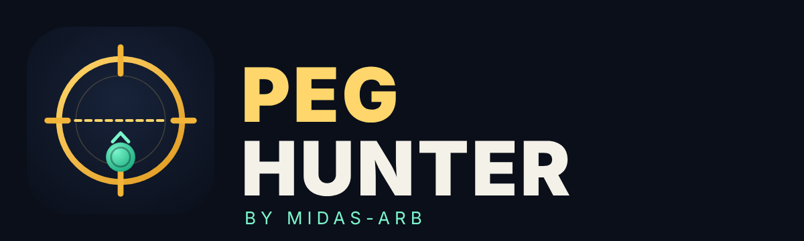

<p align="center"></p>

# Midas-arb: Peg Hunter

**A stablecoin pegged to a real currency has a known fair price: the real exchange rate.** A cNGN is worth
1/1,346 of a dollar, a EURC about $1.12, whatever a pool says. Peg Hunter watches every pool holding a
currency-pegged stablecoin on 9 cheap-gas EVM chains, compares each pool with the real exchange rate, and when one
is off by more than its fees, buys the cheap side there and sells it straight away on the same chain through a
deeper pool (or Mento / Textile on Celo, which trade at real FX rates).

Big bots skip pools with $2k of liquidity. That is where gaps of several percent can sit for minutes, so being
fast doesn't matter here, and small capital is enough to take what is there.

**Now an FX desk, like Kiyoshi (Nov 2026):** currency coins only (cNGN, wBRL, wARS, EURC, XSGD...; dollar coins are
only stepping stones in paths, `FX_ONLY=0` to trade them), DEXes plus **Textile**, on **Celo and Base** by default:
the chains where a one-hour survey of all four cheap Textile chains found gaps or near-gaps (`HUNTER_CHAINS=celo,base,bsc,polygon`
watches BSC and Polygon too; `all` runs every chain). Kiyoshi's Textile rules apply: sell to Textile only if its firm quote still covers the cost
(otherwise the loss guard sells within 0.5%), and skip a Textile-first trade while Textile still holds the last
trade's money. See [docs/FX_SURVEY.md](docs/FX_SURVEY.md) for which currencies have gaps, and the **FX quote API**
section below.

> Peg Hunter replaces the Kiyoshi v2 FX desk that used to live in this repo. The previous version is commit
> `66ac813` on `main`; to tag it: `git tag kiyoshi-v2-final 66ac813 && git push origin kiyoshi-v2-final`.

## How it works

```
 fair price (Mento oracles + 2 daily FX feeds, must agree)
        │
 every pool of every listed stablecoin, 9 chains ──► gap after gas and fees? ──► guards ──► buy cheap, sell on the same chain
        │                                                                          │
 new pools checked within 60 s                         depeg · stuck pool · suspicious price · exit pool too thin
```

- **Chains:** Celo, Base, BSC, Polygon, Arbitrum, Optimism, Avalanche, Gnosis, Sei, and Robinhood Chain (stock
  tokens, below). A chain trades only while a swap costs under $0.01 (`MAX_SWAP_GAS_USD`).
- **Exchanges:** Uniswap v3 (and Pancake, Sushi, DragonSwap) and Uniswap v4 (hookless pools, every fee tier) everywhere;
  **LFJ** on Avalanche; **Aerodrome** on Base and **Velodrome** on
  Optimism (both their concentrated and classic stable/volatile pools); **Curve** on every chain (pools found
  through Curve's API, meta pools traded through their underlying coins); **Mento** on Celo, **Textile** (RFQ at real FX rates) on Celo, Base and BSC.
  Pools that pair a coin with another dollar coin are reached in one hop through the cheapest exchange.
- **Coins:** a hand-checked list of official addresses per chain (`src/hunter/chains.ts`): EURC, EURe, EURS, EURI,
  cNGN, BRZ, wBRL, wARS, IDRX, TRYB, XSGD, CADC, ZARP, MXNe, jCHF, jGBP, GBPe, Mento's KESm, GHSm, XOFm, NGNm...
  and other dollar coins (they depeg too). The full verified list, with what was rejected and why, is in
  [docs/FX_COINS.md](docs/FX_COINS.md). Every address is checked on-chain at startup (its symbol must match), so
  copycat tokens with the same ticker are never traded. Add more with `BASE_PEGS=...` in `.env`.
- **Fair price:** Mento's on-chain oracles (fresh within minutes on weekdays) plus open.er-api.com and the
  fawazahmed0 currency API (daily). A currency is tradable only when two fresh sources agree within 2%. FX markets
  close at weekends, so older prices are accepted then.
- **Both legs on one chain:** no bridging per trade; gas is a fraction of a cent.
- **Each chain earns its place:** it watches for 3 days first, goes live only if it saw real gaps, and is paused
  if it stops making money.

## Robinhood Chain: stock tokens

Robinhood Chain has no FX coins, but it has **200+ official stock tokens** (NVDA, TSLA, AAPL, SPY, QQQ, GLD, MSTR...)
trading in Uniswap v3 pools against WETH and Uniswap v4 pools against USDG, often at several fee tiers. The same
idea applies with the stock price as the fair price:

- **Only official tokens:** the list and addresses come from Robinhood's own asset API (cached). The chain is full
  of copycats: several fake "USDG" and "USDC" with a billion tokens dumped into empty pools, and fake "HoodUSD",
  "Robinhood Gold"... so even the cash token (USDG, Paxos) is the one on Robinhood's contracts page.
- **Fair price:** Robinhood's own token price (bid/ask, already times the token's dividend multiplier: a token can
  be worth e.g. 1.0011 shares) and Hyperliquid's 24/7 stock perps (times the multiplier). They must agree within
  1.5% (`STOCK_AGREE_PCT`). For stocks Hyperliquid doesn't list, Robinhood's price stands alone (it is the issuer's;
  `STOCK_SINGLE_SOURCE=0` to require both). Over weekends Robinhood's price stands still while the perps trade,
  so most stocks pause until they agree again.
- **Routes:** between a stock's v3 fee tiers (through the deepest USDG/WETH pool) and its v4 tiers: 1,222 routes
  over 100+ stocks. Every scan first estimates all routes from one buy and one sell quote per pool, and quotes
  exactly only the ones that come close (`PREFILTER_FROM`).
- **Light on paid RPCs:** only the 25 deepest stocks (`ROBINHOOD_MAX_STOCKS`, ranked by WETH in their pools; add
  favourites with `ROBINHOOD_STOCKS`), a full scan every 2 minutes and pool-trade checks every 15 seconds
  (`<CHAIN>_INTERVAL_SEC`, `<CHAIN>_WATCH_MS` work for any chain). A scan takes under a minute on the free RPC.

## Traps it avoids

| Trap | What it looks like | What Peg Hunter does |
|---|---|---|
| A coin really lost its peg | every pool of it is "cheap", buying never ends | all of a coin's pools >3% off the same way = depeg: frozen on that chain; on 2+ chains = the whole currency frozen. Alert on Telegram |
| A price feed stopped | a fair pool looks mispriced | needs 2 agreeing fresh sources; stale or disagreeing = not traded |
| A pool nobody can trade | "off by 5%" for days | a pool off its peg for >24 h is skipped |
| Fake token or broken pool | a quote 30% from fair | anything >20% from fair is skipped |
| Textile's binding quote below its preview | stuck with the coin, sold at a small loss (Kiyoshi's log: 3 in a row) | selling to Textile is counted lower by how far its firm quotes really fell short (learned per coin from every fill; 0 until then); Textile-first routes need no margin |
| Thin exit pool | the sell leg eats the profit | sizes that move the exit pool >1% are not considered |
| Sandwich bots | the swap fills worse than quoted | 0.3% slippage limit, every transaction simulated before sending |
| Half-finished trade | coin left over after leg 1 | leg 2 never sells below leg 1's cost; leftovers sold by the loss guard (saved across restarts) |
| Bad days | losses pile up | $3 per chain and $5 overall daily loss limits |

## Scanning: where the speed comes from

A gap is worth something only while it lasts, so most of the work is about looking at the right routes often:

- **Estimate first, quote exactly second.** On chains with over 20 routes (`PREFILTER_FROM`), every route is first
  estimated from one buy and one sell quote per pool and coin, at the full, half and quarter trade size. Only
  routes that come close get exact quotes, and each one is quoted first at the size its estimate liked best; the
  other sizes are tried only if it pays there.
- **Junk routes are muted.** A route that loses over 5% at every size (an empty pool, a broken one, the wrong
  direction of a big depeg) is skipped for an hour (`JUNK_PCT`, `JUNK_MUTE_MIN`), or until a new pool appears. On
  Base that is about 240 of 740 routes.
- **Chase mode (Kiyoshi's).** When a coin has a gap, only the route that pays (and up to 2 other paying routes of
  that coin) is re-checked every 5 seconds (`CHASE_SEC`), and traded again while the gap lasts. After a winning
  trade the next check comes 1 second later (`CHASE_AFTER_TRADE_SEC`). A re-check takes about 7 seconds on Base,
  against about 2 minutes for a full scan. Full scans still run during a chase, but the chase gets at least 2/3 of
  the time.
- **Quiet chains scan less.** A chain whose best route stays more than 0.5% from profit (`QUIET_PCT`) scans 2x less
  often after 5 such scans and 3x after 10; a trade in one of its pools still triggers an instant rescan.
- **Fewer approvals.** Each approval covers 25 trades (`APPROVAL_MULT`), never an unlimited amount, so a chase does
  not stop for an approval transaction every few trades.
- **Gaps you're missing.** When a gap stays open for 30 minutes (`PERSIST_ALERT_MIN`) on a chain that isn't
  trading it (watch mode, paused, or `HUNTER_LIVE=0`), Telegram tells you, at most once every 6 hours per coin.

- **Gas-aware estimates.** A route whose estimate cannot cover its gas plus the minimum profit (within 0.1%) is not
  quoted exactly. At a $15 trade size that is almost every route, so a full Base scan takes about 10 seconds, and
  Base runs one every 15 seconds (`BASE_INTERVAL_SEC`; any chain: `<CHAIN>_INTERVAL_SEC`).

`SCAN_TIMING=1` prints how long each part of a scan took.

## Trap pools (honeypots)

Some pools are built to fool bots. Base's Curve "USDPOOL" (`0x335BE1a3...`, USDC/USDT.b) prices from an oracle
that answers one way to calls with no gas price, which is how quotes and simulations are usually made, and
another way inside real transactions. Every quote showed a 0.4% gap for hours, simulations passed, and every real
sale reverted ("Exchange resulted in fewer coins than expected"). Peg Hunter now:

- makes every quote and simulation with the network's gas price, from its own address (given a balance for the
  call only), so such a pool shows its real price and its fake gap disappears;
- stops using an exchange for a coin for 6 hours after a trade there reverts on-chain (30 minutes after one is
  refused before sending), and sells leftover coins elsewhere instead of retrying the same failure.

A pool can still find other ways to tell a quote from a trade, so a first trade on a never-traded pool is the
riskiest one; leftovers are always dollar or currency coins the loss guard can sell.

## FX quote API: what a currency trade would actually get

The desks already price every currency coin on every exchange at any size. The same quotes are served over HTTP:

```
GET /fx                          currencies covered, their oracle rate, and where each trades
GET /fx/NGN?size=50000           per exchange: effective NGN per USD for buying and for selling $50,000 worth,
                                 slippage against a $10 trade there, spread against the oracle rate, the best of each
GET /fx/NGN/history?hours=24     the recorded series ($100, $1,000, $10,000 every 5 minutes, FX_RECORD_MIN)
```

Run it on its own with `npm run fx-api` (no trading; it listens on `PORT` or `FX_API_PORT`, so it deploys to Render
as a web service as is), or inside the trading bot with `FX_API_PORT=8080`.

- **Venues:** every DEX the desks know (Uniswap v3/v4, Aerodrome, Pancake, Curve, Mento...) and Textile's RFQ
  previews. Pools priced more than 20% from the oracle are left out and listed under `excluded`.
- **Oracle:** Mento's on-chain oracles plus two daily FX feeds (the official rate). For NGN and ARS, on-chain prices
  follow the market rate, so their spread against the oracle is large and steady; the response says so.
- **Access:** `FX_API_KEYS=key1,key2` (sent as `x-api-key`) for customers on keys; `X402_PRICE_USD=0.01` makes
  everyone else pay per call with **x402** (USDC on Base). Both protocol versions are spoken: v2 (`PAYMENT-REQUIRED`
  / `PAYMENT-SIGNATURE` / `PAYMENT-RESPONSE`, network `eip155:8453`) and v1 (`X-PAYMENT`, the challenge in the 402
  body). Payments settle through **PayAI's facilitator** (`X402_FACILITATOR_URL`, default
  `https://facilitator.payai.network`; it pays the gas and needs no account), or through this server itself with
  `X402_FACILITATOR_URL=self` (the bot wallet pays ~$0.002 gas a call, no directory listing). `X402_PAY_TO`: where
  the USDC goes (your own address; required when the server has no `HUNTER_PRIVATE_KEY`, so money never goes to a
  throwaway address). With neither keys nor a price, it is open (for your own machine).
- **Limits:** 60 requests a minute per IP, sizes $1 to $1,000,000, answers cached for 10 seconds.

It publishes what public smart contracts would execute at, computed from on-chain quotes, not bureau-de-change or
parallel-market quotes. (Not legal advice; if you ever serve fiat quotes, ask a Nigerian lawyer first.)

### Going public: so agents find it and pay

Agents find paid APIs through directories that read machine-readable descriptions. The server publishes all of them:

| What | Where | Read by |
|---|---|---|
| 402 challenge with the **Bazaar** extension (what the endpoint takes and returns, service name, tags) | every paid URL | x402 clients, the x402 Bazaar (via the facilitator), x402scan |
| OpenAPI with `x-payment-info` (protocol x402, fixed price) | `/openapi.json` | x402scan (its first choice), API tools |
| List of paid URLs | `/.well-known/x402` | x402scan |
| Plain-language guide | `/llms.txt`, `/` | language-model agents, people |

Steps:
1. **Deploy** on Render with the blueprint in `render.yaml` (New > Blueprint > this repo; Starter plan, always on,
   with a 1 GB disk for the history). Set `X402_PAY_TO` (your own Base address, e.g. your exchange deposit address
   on Base or a wallet you control) and `PUBLIC_URL` (the `https://...onrender.com` address Render gives you).
2. **Check it:** open `PUBLIC_URL/llms.txt`; `curl -i PUBLIC_URL/fx/NGN` must answer `402` with a `PAYMENT-REQUIRED`
   header. x402scan's own checker: `npx -y @agentcash/discovery PUBLIC_URL -v`.
3. **Register on x402scan:** https://www.x402scan.com/resources/register, enter `PUBLIC_URL`. It reads
   `/openapi.json` and `/.well-known/x402` and lists every currency's endpoint.
4. **Get into the Bazaar:** make one real paid call through PayAI: on your phone, `npm run fx-pay -- PUBLIC_URL/fx/NGN?size=1000`
   (pays $0.01 from the bot wallet; its USDC on Base). PayAI catalogs an endpoint once a paid call carrying its
   description settles; listings rank by traffic and drop when an endpoint stops answering.
5. Watch `PUBLIC_URL/health` and the USDC arriving at `X402_PAY_TO`.

What to expect: agent traffic on x402 is real but still small, so this earns per call, a little at first. The
dataset (`/history`) gets more valuable every day it runs, and it is the part nobody else records.

## Chain lifecycle

| Mode | What happens | Moves on when |
|---|---|---|
| **watch** | scans, records what it *would* have earned (sized as if it held `WATCH_CAPITAL_USD`, $218), trades nothing | after 3 days, if it saw at least 5 gaps worth $0.10 in total and gas is cheap: **live** |
| **live** | trades (with `HUNTER_LIVE=1`) | no profit after gas over its last 7 days: **paused** |
| **paused** | its cash moves to the live chains; it does not scan at all | after 7 days: **watch** again |

`/chain base live|watch|off` on Telegram sets a chain by hand; `/chain base auto` hands it back to the rules.
A chain that is **off** does nothing at all (no scans, no RPC calls), so on a phone the chains that are on run
faster. `/only base` switches every other chain off; `/chain sei watch` turns one back on, `/chain all auto` all of
them (live chains are never changed by `/chain all`; a chain that was off starts watching from day 0). Leftover coins on a chain that is switched off are still sold.
`HUNTER_START_LIVE=celo` skips the watch period for chosen chains on the first start; a chain that is already
watching goes live with `/chain celo live`.

## Other income

Trading gaps is not the only income:

- **Interest on idle cash.** Cash mostly waits for a gap. Each treasury round parks everything above the chain's
  trading buffer (1.25x its largest trade) in **Aave v3**, where the cash token earned 7.1% on Base, 7.5% on
  Avalanche and 5.7% on Optimism in Oct 2026 (chains under `SAVINGS_MIN_APY`, 1%, are skipped). Parked cash
  still counts for trade sizes: when a trade needs it, the desk takes it out first in the same step (that gas is
  booked against the trade). Interest is booked as profit, so sweeps include it. `SAVINGS=0` turns it off.
  Aave is large and long-running but not risk-free, and a fully borrowed market can delay a withdrawal (the
  trade is then skipped).
- **Reward tokens.** Most incentive programs (Aave and pool incentives, swap rewards) pay through Merkl. Once an
  hour the treasury checks what the wallet may claim on each chain and, once it's worth $1 (`REWARDS_MIN_USD`),
  claims it, books it as profit and swaps non-cash reward tokens to cash.

Not included on purpose: liquidations (professional, flash-loan-heavy competition; see Crumbs' Kamino report) and
providing liquidity (a different, riskier business).

## Money: deposits, gas, splitting, sweeping

The treasury runs every 10 minutes while `HUNTER_LIVE=1` (or by hand: `npm run treasury -- --go`).

1. **Deposits:** send the gas token (ETH, BNB, POL, CELO, AVAX...) or the cash token to the bot wallet on any
   chain. Gas token above a $2 reserve is swapped to that chain's cash token.
2. **Gas top-ups:** a chain short of gas buys $1 of it from its own cash, or gets it bridged from the richest chain.
3. **Splitting:** cash goes to **live** chains by what each earns per dollar (last 7 days). Every live chain gets at
   least 5% and none more than 40%. Watch and paused chains hand their cash over. Moves under $5 and bridges
   costing over 2% are skipped. Until a chain is live, money stays where you deposited it.
4. **Sweeping (consolidation):** profit counts only what trades earned after gas, minus bridge fees. Deposits
   never count. When profit not yet swept reaches **$20**, **50%** of it is bridged to **BSC as USDT**
   (`SWEEP_CHAIN`, `SWEEP_TOKEN`), to `SWEEP_TO`: your exchange deposit address or your own wallet. The other half
   stays and keeps trading. A chain whose part is under $3 waits for the next sweep. `/withdraw` sweeps now.
   - If `SWEEP_TO` is empty, swept money stays in the bot wallet on BSC, **set aside** (never traded). After you
     withdraw it by hand, run `npm run withdraw -- --release 25` so the bot stops setting that $25 aside.
5. **Trade size grows with the money:** the size search picks the most profitable size up to 90% of that chain's
   cash (`TRADE_PCT`, as Kiyoshi), at most $200 (`MAX_TRADE_USD_CAP`), testing each route from $50 (`MIN_TRADE_USD`) up. A trade must make at least $0.01 after gas
   and fees (`MIN_NET_USD`; Kiyoshi asks $0.01 before gas).

## Run it on Termux (Android)

You need Termux (from F-Droid) with Node.js and git, as for Kiyoshi.

```
pkg install nodejs git
cd ~ && git clone https://github.com/Midas3007/midas-arb && cd midas-arb
npm install
cp .env.example .env
npm run new-wallet          # a NEW wallet, only for Peg Hunter
nano .env                   # paste the key after HUNTER_PRIVATE_KEY=, keep HUNTER_LIVE=0
npm run check               # read-only: chains, exchanges, coins, fair prices
termux-wake-lock
npm start                   # watch only: scans every chain, trades nothing
```

Leave it watching for 3 days, then `npm run report`. It shows, per chain, the gaps it saw, what they would have
earned, which routes, and how long gaps stayed open. To trade:

1. Fund the wallet: a little gas token on each chain you expect to use, and cash (or more gas token, which is
   converted) on any one chain.
2. Set `HUNTER_LIVE=1` and `SWEEP_TO=` your withdrawal address in `.env`, then `npm start` again.
3. Chains that earned their place in watch mode trade; the treasury moves cash to them.

**Keep it running by itself:** `npm run forever` instead of `npm start` restarts Peg Hunter 10 seconds after any
crash (Ctrl+C still stops it). RPC addresses that don't answer (down, or out of credits like a used-up QuickNode
trial) move to the back and are re-checked every minute, so one that recovers is used again, and a daily summary arrives on Telegram at 20:00 UTC
(`DAILY_REPORT_UTC`).

### Going live, safely

1. Let the watch run (`npm run report`, `/status`). Chains that find gaps go live by themselves after 3 days; to start
   one now: `HUNTER_START_LIVE=celo,base`.
2. Fund only those chains: a little gas token, plus cash (or gas token, which is converted).
3. **Test trade first:** `HUNTER_LIVE=1` and `TEST_TRADE=base` (one chain). On its first scan the bot makes one $2 round
   trip on that chain's best route, profitable or not (it may cost a cent), and reports the result on Telegram. It
   runs once (`data/<chain>/test-trade.done`); delete that file to run it again. This proves approvals, swaps, gas
   accounting and the ledger on that chain before real-size trades.
4. Then remove `TEST_TRADE` and let it trade. Raise `WATCH_CAPITAL_USD`/`MAX_TRADE_USD_CAP` as the money grows.

Stop with `CTRL`+`c`: it stops at once. Only if a transaction is being sent at that moment (a trade's legs, a
bridge, an Aave deposit) does it wait for that, and `CTRL`+`c` again forces it.
**Updates:** `git pull && npm install`, then start again.

### Moving to Render later

Once `npm run report` shows which chains make money, run only those on Render with `HUNTER_CHAINS=celo,base`
(and keep the rest on the phone with the complement, or switch them off). One wallet must not run in two places
for the same chain. Copy `data/` along so the ledger and sweep marks carry over.

## Telegram

Create a bot with @BotFather, message it once, read your chat id from
`https://api.telegram.org/bot<TOKEN>/getUpdates`, put both in `.env`. Only your chat is obeyed.

Send `/menu` (or `/start`) for the **command panel**: buttons that update the same message in place.

| Button / command | |
|---|---|
| 📊 Status · `/status` | profit (all time, today, not yet swept, swept), each chain's mode, cash and results |
| 📡 Scans · `/scans` | each chain's latest scan line: what it is seeing right now, how long ago, gas per swap |
| 🎯 Gaps · `/gaps` | pools furthest from their peg (buttons for ≥0.2%, 0.5%, 1%, 3%) |
| ⛓ Chains · `/chains` | each chain's mode; tap a chain for 🟢 live · 👀 watch · ⛔ off · 🤖 auto |
| 💸 Withdraw · `/withdraw` | sweep profit now (asks to confirm) |
| ⏯ Pause / Resume · `/pause` `/resume` | stop / restart new trades |

**Switching chains:** `/switch celo` (or 🔀 in the menu) moves **all** the money to Celo: cash parked in Aave comes
out, every chain's cash token is bridged to Celo's cash token and its gas token (less the gas of sending it) to
CELO, through LI.FI's cheapest route. Celo goes live and the chains the money came from (and any other live
chain) are switched off. You see the plan with each bridge's cost first and confirm with a button; progress
messages follow. If no bridge offers the target's gas token, the gas token arrives as cash and $1 of the cash
buys the target's gas instead. `/switch` alone shows buttons with the gaps each chain saw in the last 24 hours
(`/switch best` picks the most). Money set aside for withdrawal stays put; leftover coins from a half-finished
trade are sold on their own chain first (run `/switch` again to bring that cash over). The treasury pauses while
a switch runs.

The commands also appear in Telegram's "/" menu. Typed `/chain base live` still works, and so do `/only base`
(every other chain off) and `/chain all watch|off|auto`.

Alerts: start, trades of $1 or more, depeg freezes, new pools of our coins, chains promoted or paused, sweeps,
failed second legs.

## Commands

| | |
|---|---|
| `npm start` | run (all chains, or `npm start -- base celo`) |
| `npm run check` | read-only health check |
| `npm run report` | what each chain saw and earned (`-- 7` for a week) |
| `npm run treasury` | one treasury round, plan only (`-- --go` to do it) |
| `npm run withdraw` | sweep now, plan only (`-- --go` to do it) |
| `npm test` / `npm run typecheck` | 38 tests: engine, peg guards, fair price, lifecycle, splitting, sweeping, parking, rewards |

## Files

`data/state.json` (modes, sweep marks, set-aside money), `data/ledger.jsonl` (every realized result), and per chain
`data/<chain>/`: `trades.jsonl`, `opps.jsonl` (every gap worth trading), `scans.jsonl`, `pending.json` (leftovers).

## Limits

- Not audited. Keep only trading capital in the bot wallet.
- Gaps come from other people's trades and new pools; quiet weeks earn little. The watch period exists to measure
  this before risking money.
- Mento's oracles stop at weekends, so Mento routes close then. Textile and the pools keep trading.
- On the free public RPCs most chains finish a scan in seconds, but Polygon and Arbitrum (the most pools) take
  1-2 minutes per scan. Gaps here last minutes, so that works, but a free Alchemy/Ankr key in `POLYGON_RPCS=` /
  `ARBITRUM_RPCS=` makes them much faster. `RPC_CONCURRENCY` (default 8) is how many quotes each chain runs at once.
- Not covered yet: Balancer (only small pools hold our coins; its one big EURe pool pairs with Aave-wrapped USDC),
  Uniswap v4 on Gnosis and Sei (not deployed there), Thena/other Algebra exchanges (BSC).
- Each trade is two transactions. A one-transaction contract (no leftovers possible) is planned for chains that
  prove profitable (see `docs/PEG_HUNTER_PLAN.md`).
