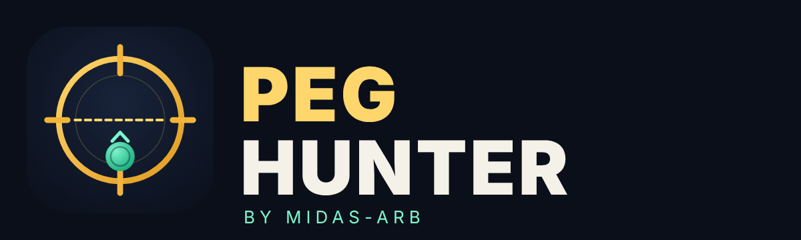

<p align="center"></p>

# Midas-arb: Peg Hunter

**A stablecoin pegged to a real currency has a known fair price: the real exchange rate.** A cNGN is worth
1/1,346 of a dollar, a EURC about $1.12, whatever a pool says. Peg Hunter watches every pool holding a
currency-pegged stablecoin on 9 cheap-gas EVM chains, compares each pool with the real exchange rate, and when one
is off by more than its fees, buys the cheap side there and sells it straight away on the same chain through a
deeper pool (or Mento / Textile on Celo, which trade at real FX rates).

Big bots skip pools with $2k of liquidity. That is where gaps of several percent can sit for minutes, so being
fast doesn't matter here, and small capital is enough to take what is there.

> Peg Hunter replaces the Kiyoshi v2 FX desk that used to live in this repo. The previous version is commit
> `66ac813` on `main`; to tag it: `git tag kiyoshi-v2-final 66ac813 && git push origin kiyoshi-v2-final`.

## How it works

```
 fair price (Mento oracles + 2 daily FX feeds, must agree)
        │
 every pool of every listed stablecoin, 9 chains ──► gap after gas and fees? ──► guards ──► buy cheap, sell on the same chain
        │                                                                          │
 new pools checked within 60 s                         depeg · stuck pool · suspicious price · exit pool too thin
```

- **Chains:** Celo, Base, BSC, Polygon, Arbitrum, Optimism, Avalanche, Gnosis, Sei, and Robinhood Chain (stock
  tokens, below). A chain trades only while a swap costs under $0.01 (`MAX_SWAP_GAS_USD`).
- **Exchanges:** Uniswap v3 (and Pancake, Sushi, DragonSwap) everywhere; **Aerodrome** on Base and **Velodrome** on
  Optimism (both their concentrated and classic stable/volatile pools); **Curve** on every chain (pools found
  through Curve's API, meta pools traded through their underlying coins); **Mento** on Celo, **Textile** (RFQ at real FX rates) on Celo, Base and BSC.
  Pools that pair a coin with another dollar coin are reached in one hop through the cheapest exchange.
- **Coins:** a hand-checked list of official addresses per chain (`src/hunter/chains.ts`): EURC, EURe, EURS, EURI,
  cNGN, BRZ, wBRL, wARS, IDRX, TRYB, XSGD, CADC, ZARP, MXNe, jCHF, jGBP, GBPe, Mento's KESm, GHSm, XOFm, NGNm...
  and other dollar coins (they depeg too). The full verified list, with what was rejected and why, is in
  [docs/FX_COINS.md](docs/FX_COINS.md). Every address is checked on-chain at startup (its symbol must match), so
  copycat tokens with the same ticker are never traded. Add more with `BASE_PEGS=...` in `.env`.
- **Fair price:** Mento's on-chain oracles (fresh within minutes on weekdays) plus open.er-api.com and the
  fawazahmed0 currency API (daily). A currency is tradable only when two fresh sources agree within 2%. FX markets
  close at weekends, so older prices are accepted then.
- **Both legs on one chain:** no bridging per trade; gas is a fraction of a cent.
- **Each chain earns its place:** it watches for 3 days first, goes live only if it saw real gaps, and is paused
  if it stops making money.

## Robinhood Chain: stock tokens

Robinhood Chain has no FX coins, but it has **200+ official stock tokens** (NVDA, TSLA, AAPL, SPY, QQQ, GLD, MSTR...)
trading in Uniswap v3 pools against WETH and Uniswap v4 pools against USDG, often at several fee tiers. The same
idea applies with the stock price as the fair price:

- **Only official tokens:** the list and addresses come from Robinhood's own asset API (cached). The chain is full
  of copycats: several fake "USDG" and "USDC" with a billion tokens dumped into empty pools, and fake "HoodUSD",
  "Robinhood Gold"... so even the cash token (USDG, Paxos) is the one on Robinhood's contracts page.
- **Fair price:** Robinhood's own token price (bid/ask, already times the token's dividend multiplier: a token can
  be worth e.g. 1.0011 shares) and Hyperliquid's 24/7 stock perps (times the multiplier). They must agree within
  1.5% (`STOCK_AGREE_PCT`). For stocks Hyperliquid doesn't list, Robinhood's price stands alone (it is the issuer's;
  `STOCK_SINGLE_SOURCE=0` to require both). Over weekends Robinhood's price stands still while the perps trade,
  so most stocks pause until they agree again.
- **Routes:** between a stock's v3 fee tiers (through the deepest USDG/WETH pool) and its v4 tiers: 1,222 routes
  over 100+ stocks. Every scan first estimates all routes from one buy and one sell quote per pool, and quotes
  exactly only the ones that come close (`PREFILTER_FROM`).
- **Light on paid RPCs:** only the 25 deepest stocks (`ROBINHOOD_MAX_STOCKS`, ranked by WETH in their pools; add
  favourites with `ROBINHOOD_STOCKS`), a full scan every 2 minutes and pool-trade checks every 15 seconds
  (`<CHAIN>_INTERVAL_SEC`, `<CHAIN>_WATCH_MS` work for any chain). A scan takes under a minute on the free RPC.

## Traps it avoids

| Trap | What it looks like | What Peg Hunter does |
|---|---|---|
| A coin really lost its peg | every pool of it is "cheap", buying never ends | all of a coin's pools >3% off the same way = depeg: frozen on that chain; on 2+ chains = the whole currency frozen. Alert on Telegram |
| A price feed stopped | a fair pool looks mispriced | needs 2 agreeing fresh sources; stale or disagreeing = not traded |
| A pool nobody can trade | "off by 5%" for days | a pool off its peg for >24 h is skipped |
| Fake token or broken pool | a quote 30% from fair | anything >20% from fair is skipped |
| Thin exit pool | the sell leg eats the profit | sizes that move the exit pool >1% are not considered |
| Sandwich bots | the swap fills worse than quoted | 0.3% slippage limit, every transaction simulated before sending |
| Half-finished trade | coin left over after leg 1 | leg 2 never sells below leg 1's cost; leftovers sold by the loss guard (saved across restarts) |
| Bad days | losses pile up | $3 per chain and $5 overall daily loss limits |

## Chain lifecycle

| Mode | What happens | Moves on when |
|---|---|---|
| **watch** | scans, records what it *would* have earned (sized as if it held $20), trades nothing | after 3 days, if it saw at least 5 gaps worth $0.10 in total and gas is cheap: **live** |
| **live** | trades (with `HUNTER_LIVE=1`) | no profit after gas over its last 7 days: **paused** |
| **paused** | its cash moves to the live chains | after 7 days: **watch** again |

`/chain base live|watch|off` on Telegram sets a chain by hand; `/chain base auto` hands it back to the rules.
`HUNTER_START_LIVE=celo` skips the watch period for chosen chains.

## Other income

Trading gaps is not the only income:

- **Interest on idle cash.** Cash mostly waits for a gap. Each treasury round parks everything above the chain's
  trading buffer (1.25x its largest trade) in **Aave v3**, where the cash token earned 7.1% on Base, 7.5% on
  Avalanche and 5.7% on Optimism in Oct 2026 (chains under `SAVINGS_MIN_APY`, 1%, are skipped). Parked cash
  still counts for trade sizes: when a trade needs it, the desk takes it out first in the same step (that gas is
  booked against the trade). Interest is booked as profit, so sweeps include it. `SAVINGS=0` turns it off.
  Aave is large and long-running but not risk-free, and a fully borrowed market can delay a withdrawal (the
  trade is then skipped).
- **Reward tokens.** Most incentive programs (Aave and pool incentives, swap rewards) pay through Merkl. Once an
  hour the treasury checks what the wallet may claim on each chain and, once it's worth $1 (`REWARDS_MIN_USD`),
  claims it, books it as profit and swaps non-cash reward tokens to cash.

Not included on purpose: liquidations (professional, flash-loan-heavy competition; see Crumbs' Kamino report) and
providing liquidity (a different, riskier business).

## Money: deposits, gas, splitting, sweeping

The treasury runs every 10 minutes while `HUNTER_LIVE=1` (or by hand: `npm run treasury -- --go`).

1. **Deposits:** send the gas token (ETH, BNB, POL, CELO, AVAX...) or the cash token to the bot wallet on any
   chain. Gas token above a $2 reserve is swapped to that chain's cash token.
2. **Gas top-ups:** a chain short of gas buys $1 of it from its own cash, or gets it bridged from the richest chain.
3. **Splitting:** cash goes to **live** chains by what each earns per dollar (last 7 days). Every live chain gets at
   least 5% and none more than 40%. Watch and paused chains hand their cash over. Moves under $5 and bridges
   costing over 2% are skipped. Until a chain is live, money stays where you deposited it.
4. **Sweeping (consolidation):** profit counts only what trades earned after gas, minus bridge fees. Deposits
   never count. When profit not yet swept reaches **$20**, **50%** of it is bridged to **BSC as USDT**
   (`SWEEP_CHAIN`, `SWEEP_TOKEN`), to `SWEEP_TO`: your exchange deposit address or your own wallet. The other half
   stays and keeps trading. A chain whose part is under $3 waits for the next sweep. `/withdraw` sweeps now.
   - If `SWEEP_TO` is empty, swept money stays in the bot wallet on BSC, **set aside** (never traded). After you
     withdraw it by hand, run `npm run withdraw -- --release 25` so the bot stops setting that $25 aside.
5. **Trade size grows with the money:** the size search picks the most profitable size up to 90% of that chain's
   cash (`TRADE_PCT`, as Kiyoshi), at most $200 (`MAX_TRADE_USD_CAP`), testing each route from $50 (`MIN_TRADE_USD`) up. A trade must make at least $0.02 after gas
   and fees (`MIN_NET_USD`, Kiyoshi's rule).

## Run it on Termux (Android)

You need Termux (from F-Droid) with Node.js and git, as for Kiyoshi.

```
pkg install nodejs git
cd ~ && git clone https://github.com/Midas3007/midas-arb && cd midas-arb
npm install
cp .env.example .env
npm run new-wallet          # a NEW wallet, only for Peg Hunter
nano .env                   # paste the key after HUNTER_PRIVATE_KEY=, keep HUNTER_LIVE=0
npm run check               # read-only: chains, exchanges, coins, fair prices
termux-wake-lock
npm start                   # watch only: scans every chain, trades nothing
```

Leave it watching for 3 days, then `npm run report`. It shows, per chain, the gaps it saw, what they would have
earned, which routes, and how long gaps stayed open. To trade:

1. Fund the wallet: a little gas token on each chain you expect to use, and cash (or more gas token, which is
   converted) on any one chain.
2. Set `HUNTER_LIVE=1` and `SWEEP_TO=` your withdrawal address in `.env`, then `npm start` again.
3. Chains that earned their place in watch mode trade; the treasury moves cash to them.

Stop with `CTRL`+`c`: it stops at once. Only if a transaction is being sent at that moment (a trade's legs, a
bridge, an Aave deposit) does it wait for that, and `CTRL`+`c` again forces it.
**Updates:** `git pull && npm install`, then start again.

### Moving to Render later

Once `npm run report` shows which chains make money, run only those on Render with `HUNTER_CHAINS=celo,base`
(and keep the rest on the phone with the complement, or switch them off). One wallet must not run in two places
for the same chain. Copy `data/` along so the ledger and sweep marks carry over.

## Telegram

Create a bot with @BotFather, message it once, read your chat id from
`https://api.telegram.org/bot<TOKEN>/getUpdates`, put both in `.env`. Only your chat is obeyed.

Send `/menu` (or `/start`) for the **command panel**: buttons that update the same message in place.

| Button / command | |
|---|---|
| 📊 Status · `/status` | profit (all time, today, not yet swept, swept), each chain's mode, cash and results |
| 📡 Scans · `/scans` | each chain's latest scan line: what it is seeing right now, how long ago, gas per swap |
| 🎯 Gaps · `/gaps` | pools furthest from their peg (buttons for ≥0.2%, 0.5%, 1%, 3%) |
| ⛓ Chains · `/chains` | each chain's mode; tap a chain for 🟢 live · 👀 watch · ⛔ off · 🤖 auto |
| 💸 Withdraw · `/withdraw` | sweep profit now (asks to confirm) |
| ⏯ Pause / Resume · `/pause` `/resume` | stop / restart new trades |

The commands also appear in Telegram's "/" menu. Typed `/chain base live` still works.

Alerts: start, trades of $1 or more, depeg freezes, new pools of our coins, chains promoted or paused, sweeps,
failed second legs.

## Commands

| | |
|---|---|
| `npm start` | run (all chains, or `npm start -- base celo`) |
| `npm run check` | read-only health check |
| `npm run report` | what each chain saw and earned (`-- 7` for a week) |
| `npm run treasury` | one treasury round, plan only (`-- --go` to do it) |
| `npm run withdraw` | sweep now, plan only (`-- --go` to do it) |
| `npm test` / `npm run typecheck` | 38 tests: engine, peg guards, fair price, lifecycle, splitting, sweeping, parking, rewards |

## Files

`data/state.json` (modes, sweep marks, set-aside money), `data/ledger.jsonl` (every realized result), and per chain
`data/<chain>/`: `trades.jsonl`, `opps.jsonl` (every gap worth trading), `scans.jsonl`, `pending.json` (leftovers).

## Limits

- Not audited. Keep only trading capital in the bot wallet.
- Gaps come from other people's trades and new pools; quiet weeks earn little. The watch period exists to measure
  this before risking money.
- Mento's oracles stop at weekends, so Mento routes close then. Textile and the pools keep trading.
- On the free public RPCs most chains finish a scan in seconds, but Polygon and Arbitrum (the most pools) take
  1-2 minutes per scan. Gaps here last minutes, so that works, but a free Alchemy/Ankr key in `POLYGON_RPCS=` /
  `ARBITRUM_RPCS=` makes them much faster. `RPC_CONCURRENCY` (default 8) is how many quotes each chain runs at once.
- Not covered yet: Balancer (Gnosis), LFJ (Avalanche), Uniswap v4 pools, Thena/other Algebra exchanges (BSC).
- Each trade is two transactions. A one-transaction contract (no leftovers possible) is planned for chains that
  prove profitable (see `docs/PEG_HUNTER_PLAN.md`).
